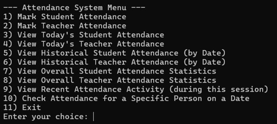
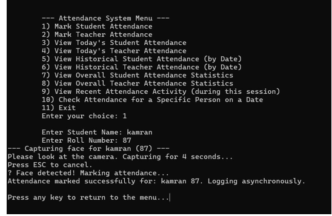
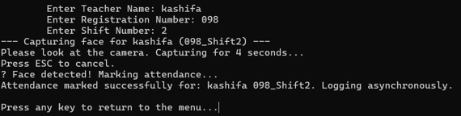
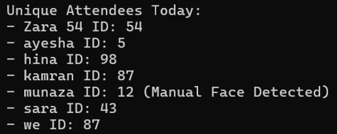
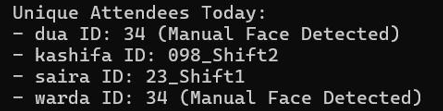
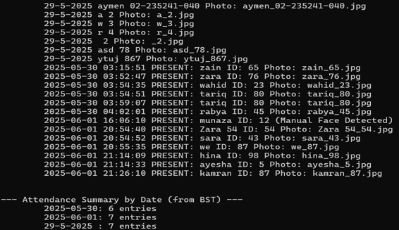
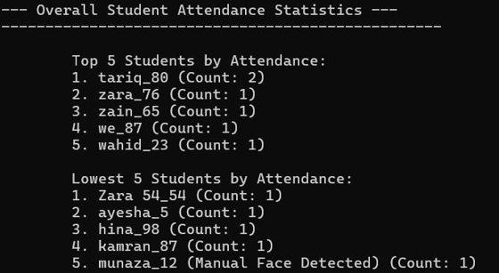
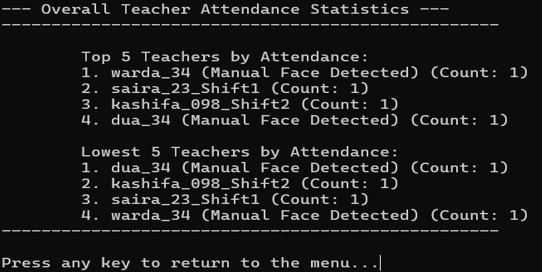
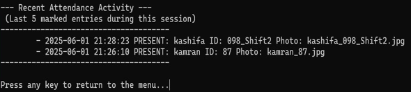
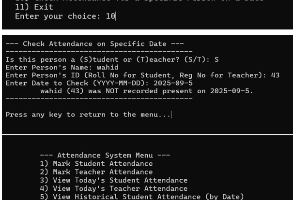

# Face Detection–Based Attendance System

A C++17 and OpenCV attendance-tracking application that uses a webcam to detect a face before recording attendance for students or teachers. It provides a terminal-based menu, dated attendance logs, reports, and simple activity statistics.

> **How verification works:** The operator enters a person's name and ID. The program uses an OpenCV Haar cascade to check that a face is visible and save a cropped image before recording attendance. **It does not recognise faces or verify that the detected face belongs to the entered identity.**

## Features

- **Student and teacher attendance** — Record attendance separately; teacher entries can include a shift number.
- **Webcam-based face detection** — Uses OpenCV's frontal-face Haar cascade and displays a camera preview with a face bounding box.
- **Face snapshots** — Saves a cropped image of the detected face in `attendance_photos/`.
- **Timestamped records** — Writes student, teacher, and combined attendance logs to text files.
- **Duplicate-entry cooldown** — Prevents repeated attempts for the same name/ID within a five-second window during a running session.
- **Attendance reports** — View today's entries, historical logs, and a date-organised historical summary.
- **Attendance statistics** — Displays highest and lowest attendance counts using priority queues.
- **Recent activity** — Shows the five most recent attendance entries from the current session.
- **Date lookup** — Check whether a student or teacher has a recorded entry for a particular date.
- **Background logging** — Uses a worker thread and a thread-safe queue for the combined attendance log.

## Application Screenshots

These screenshots show actual application runs with fictional demonstration names and IDs. Cropped to focus on each workflow; terminal text and results are unchanged. Expand a section and click an image for full resolution, especially on mobile.

### Attendance System Menu

[](docs/screenshots/01-attendance-menu.png)

<details>
<summary><strong>Student and Teacher Attendance</strong></summary>

**Student attendance** — Face detection and logging confirmation.

[](docs/screenshots/02-student-attendance.png)

**Teacher attendance** — Name, registration number, shift and logging confirmation.

[](docs/screenshots/03-teacher-attendance.png)

</details>

<details>
<summary><strong>Daily Attendance Reports</strong></summary>

**Student report** — Unique student attendees for the day.

[](docs/screenshots/04-student-daily-report.png)

**Teacher report** — Unique teacher attendees for the day.

[](docs/screenshots/05-teacher-daily-report.png)

</details>

<details>
<summary><strong>Historical Attendance and Date-Based Summary</strong></summary>

Historical student log excerpt and date-based counts from the Binary Search Tree.

[](docs/screenshots/06-historical-summary.png)

</details>

<details>
<summary><strong>Student and Teacher Statistics</strong></summary>

**Student statistics** — Highest and lowest attendance counts.

[](docs/screenshots/07-student-statistics.png)

**Teacher statistics** — Highest and lowest attendance counts.

[](docs/screenshots/08-teacher-statistics.png)

</details>

<details>
<summary><strong>Recent Attendance Activity</strong></summary>

The most recent attendance entries from the current session (up to five).

[](docs/screenshots/09-recent-activity.png)

</details>

<details>
<summary><strong>Attendance Lookup by Date</strong></summary>

**Date lookup** — This example returns “not recorded present”.

[](docs/screenshots/10-date-lookup.png)

</details>

The supplied daily and historical captures omit report headings; the student-statistics capture omits the bottom separator. The visible results are preserved without reconstructing missing content.

## Technology

| Area | Implementation |
| --- | --- |
| Language | C++17 |
| Computer vision | OpenCV, Haar cascade face detection |
| Interface | Terminal menu and OpenCV camera window |
| Data structures | Binary Search Tree for date-based historical summaries; priority queues for attendance rankings; unordered maps for cooldown tracking and attendance counts; sets for unique attendees; lists for recent activity |
| Concurrency | `std::thread`, mutexes, condition variable and atomic flag |
| Storage | Local text logs and JPEG face snapshots |

## How it works

1. Choose to mark **student** or **teacher** attendance from the terminal menu.
2. Enter the person's name and ID; teacher attendance additionally asks for a shift.
3. The application opens the default webcam and attempts face detection for approximately four seconds.
4. When a face is detected, it saves the face crop and adds a timestamped attendance record. If no face is detected or the capture is cancelled, attendance is not recorded.
5. Use the menu to inspect attendance history, daily reports and statistics.

## Run locally

### Prerequisites

- A C++17-compatible compiler (for example, `g++`)
- OpenCV development libraries and headers
- A working webcam and a graphical desktop session for OpenCV's camera window
- OpenCV's `haarcascade_frontalface_default.xml` cascade file

On Ubuntu or Debian, the required development packages can typically be installed with:

```bash
sudo apt update
sudo apt install g++ pkg-config libopencv-dev
```

Clone the repository:

```bash
git clone https://github.com/aymenmansoor/Face-Detection-Based-Attendance-System.git
cd Face-Detection-Based-Attendance-System
```

Place `haarcascade_frontalface_default.xml` in the directory from which you run the program. The cascade is supplied by the OpenCV project; see the [official Haar cascades directory](https://github.com/opencv/opencv/tree/4.x/data/haarcascades).

Compile:

```bash
g++ -std=c++17 -pthread main.cpp -o attendance-system $(pkg-config --cflags --libs opencv4)
```

Run:

```bash
./attendance-system
```

These are source-based setup instructions; a fresh build and webcam run have not been independently verified for this repository.

## Local output

The program creates or updates these local files during use:

| Output | Purpose |
| --- | --- |
| `attendance_photos/` | Cropped face images saved after detection |
| `studentattendance_log.txt` | Student attendance entries |
| `teacherattendance_log.txt` | Teacher attendance entries |
| `combined_attendance_log.txt` | Combined log written by the background worker |

Attendance counts are rebuilt from the student and teacher logs on startup. The cooldown cache and recent-activity list apply to the current process session.

## Project structure

```text
Face-Detection-Based-Attendance-System/
├── main.cpp       # Terminal UI, face detection, logging and reports
├── README.md      # Project documentation
└── docs/
    └── screenshots/  # 10 genuine application screenshots
```

The OpenCV cascade XML file is a separate runtime requirement and is not currently included in the repository.

## Privacy Considerations

The application stores attendance records and captured face images locally. It is intended for use with appropriate consent and responsible handling of personal data.

## Scope

This is a local, single-application C++/OpenCV project demonstrating face detection, file-based attendance tracking, concurrency and data structures. It is **not** a biometric identity-verification system.
